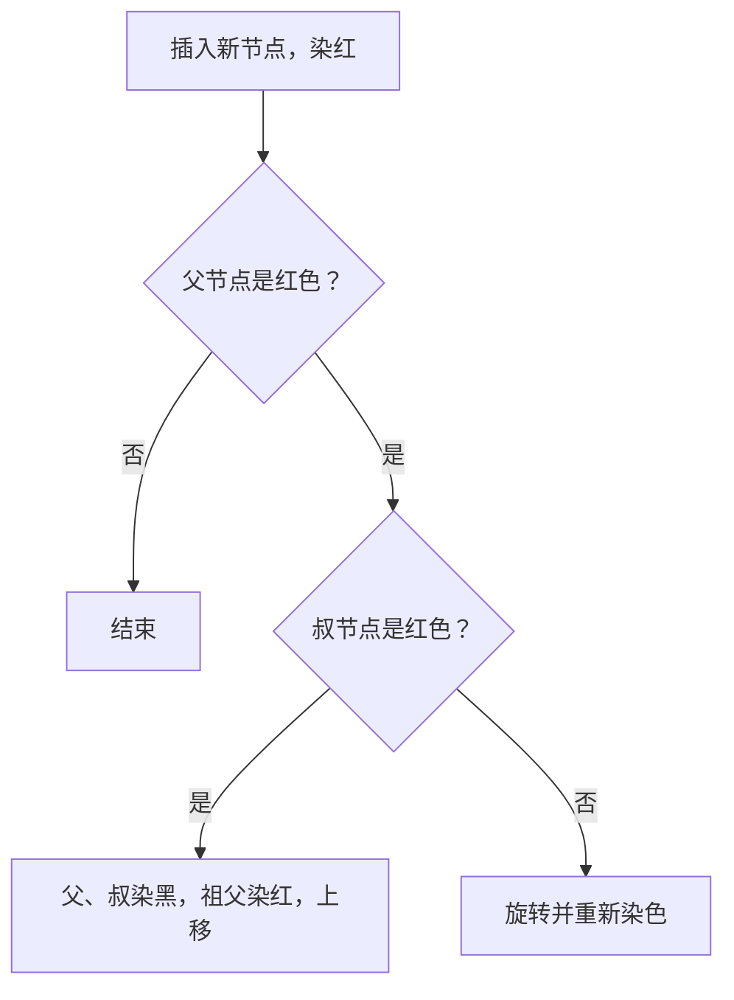

# 技术验证测试文档

这篇文档用来在平板上测试选区、划线、公式和提问。内容取自红黑树和哈希表的基础知识，每一节都故意放了容易出问题的写法。

## 1. 普通段落与重复句子

红黑树是一种自平衡的二叉查找树。它在每个节点上多存一位颜色信息，用颜色规则限制树的高度。

下面这句话在本节和第 3 节都会出现，用来测试锚点能否靠前后文找到正确位置：

查找、插入和删除的时间复杂度都是对数级别。

一棵树如果不做平衡，最坏情况下会退化成链表，此时操作的代价随节点数线性增长。

## 2. 行内公式

红黑树的高度满足 $h \le 2\log_2(n+1)$，其中 $n$ 是内部节点数。哈希表在负载因子 $\alpha = n/m$ 较小时，平均查找长度接近 $1 + \alpha/2$。

请分别试试：只选中上面某个公式的一部分、从公式前一个字选到公式后一个字、选中包含公式的整句话。

## 3. 公式块

插入后需要调整颜色和旋转。从根到任意叶子路径上的黑色节点数相同，记为黑高 $bh(x)$，以 $x$ 为根的子树至少包含的内部节点数为：

$$
n(x) \ge 2^{bh(x)} - 1
$$

由此可以推出树高的上界。查找、插入和删除的时间复杂度都是对数级别。

请试试选中包含上面公式块的整个段落。

## 4. 代码

左旋操作的 Python 写法：

```python
def left_rotate(tree, x):
    y = x.right
    x.right = y.left
    if y.left is not tree.nil:
        y.left.parent = x
    y.parent = x.parent
    if x.parent is tree.nil:
        tree.root = y
    elif x is x.parent.left:
        x.parent.left = y
    else:
        x.parent.right = y
    y.left = x
    x.parent = y
```

一条用来测试 bash 高亮的命令：

```bash
npm run test && npm run build
```

行内代码也要能选中，例如 `tree.nil` 和 `left_rotate`。

## 5. 表格

| 结构 | 查找（平均） | 查找（最坏） |
| --- | --- | --- |
| 普通二叉查找树 | O(log n) | O(n) |
| 红黑树 | O(log n) | O(log n) |
| 哈希表 | O(1) | O(n) |

## 6. 提示块

> [!tip] 一句话记住
> 红黑树用颜色规则换来了近似平衡，旋转次数比 AVL 树少。

> [!warning] 注意
> 删除操作的修复情况比插入多，是最容易写错的部分。

## 7. Mermaid 代码块

第一版按普通代码块显示，第二版再渲染成图：



## 8. 长段落

这一段用来测试跨段落选区和滚动位置恢复。哈希表通过哈希函数把键映射到数组下标，冲突时可以用链地址法或开放地址法解决。链地址法在每个桶里挂一条链表，实现简单，负载因子可以大于一；开放地址法把所有元素放在数组里，冲突时按探测序列寻找下一个空位，缓存友好，但负载因子必须小于一，删除时还要留下墓碑标记。

扩容时通常把容量翻倍，并把所有元素重新哈希到新数组里。单次扩容代价较高，但摊还到每次插入上仍然是常数级别。请试试从上一段中间选到这一段中间。
